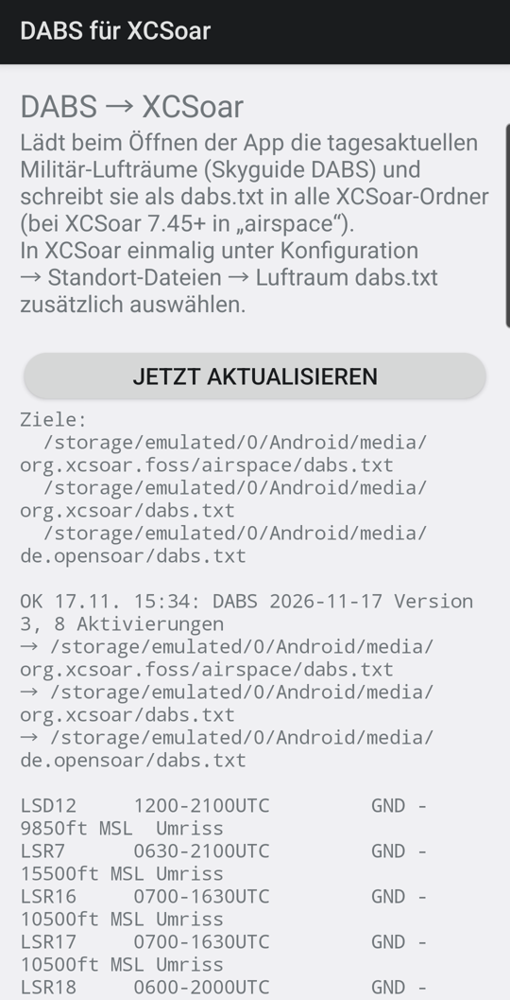

# DABS für XCSoar

Android-App, die die **tagesaktuellen Militär-Lufträume der Schweiz** (Skyguide *DABS – Daily Airspace
Bulletin Switzerland*) als OpenAir-Datei `dabs.txt` in den Datenordner von **XCSoar** schreibt.
So zeigt XCSoar nur die Gebiete an, die heute wirklich aktiv sind – mit ihrer echten Form, Höhe und
Aktivierungszeit.



## So funktioniert's

1. Beim **Öffnen der App** (oder mit „Jetzt aktualisieren“) lädt sie das aktuelle DABS-PDF von
   [skybriefing.com](https://www.skybriefing.com/o/dabs?today).
2. Aus dem PDF werden alle aktivierten Gebiete gelesen (LS-R, LS-D, temporäre W-NOTAM-Gebiete),
   jeweils mit Zeiten (UTC), Unter- und Obergrenze.
3. Die echten Umrisse der R-/D-Gebiete kommen aus der Luftraum-API des SHV/FSVL
   ([airspace.shv-fsvl.ch](https://airspace.shv-fsvl.ch)). Für Gebiete ohne Umriss
   (z. B. temporäre NOTAMs) wird ein Kreis aus Mittelpunkt und Radius des DABS gezeichnet.
4. Die App schreibt `dabs.txt` in **alle** gefundenen XCSoar-Installationen:

   | App | Ordner |
   |---|---|
   | XCSoar 7.45+ (`org.xcsoar.foss`, `org.xcsoar`) | `Android/media/<paket>/airspace/dabs.txt` |
   | XCSoar 7.43 und älter | `Android/media/org.xcsoar/dabs.txt` |
   | OpenSoar | `Android/media/de.opensoar/dabs.txt` |

Die Gebietsnamen enthalten Datum und Zeiten, z. B. `LSR7 Hongrin 17.11. 0630-2100UTC` –
so sieht man in XCSoar sofort, wenn die Daten nicht von heute sind.

Die App läuft **nicht im Hintergrund**: Daten werden nur geholt, wenn du sie öffnest.

## Installation

1. Die neueste `dabs-xcsoar-<version>.apk` unter [Releases](../../releases) aufs Handy laden.
2. Öffnen und die Installation aus unbekannten Quellen erlauben.
3. App starten → **„Dateizugriff erlauben“** → *Zugriff auf alle Dateien* einschalten.
   (Nötig, weil die App in den Ordner einer anderen App – XCSoar – schreibt.)
4. Zurück in der App lädt sie sofort die Daten.

Voraussetzung: Android 8 oder neuer, XCSoar mindestens einmal gestartet.

## Einrichtung in XCSoar (einmalig)

**Konfiguration → System → Standort-Dateien → Luftraum:** `dabs.txt` **zusätzlich** zu deiner
normalen Schweizer Luftraumdatei auswählen (XCSoar 7.45 kann mehrere Dateien gleichzeitig laden;
ältere Versionen haben dafür das Feld „Weitere Luftraumdatei“).

Wichtig: Die normale Luftraumdatei sollte **keine** DABS-Gebiete enthalten (z. B.
`CH-ASP-DABS-SegelflugCH.txt` oder eine Variante „ohne DABS“), sonst erscheinen alle
R-/D-Gebiete immer – egal ob aktiv.

**Vor dem Flug:** erst die DABS-App öffnen, bis „OK“ erscheint, dann XCSoar starten.
XCSoar liest Luftraumdateien nur beim Start (oder nach Änderungen in der Konfiguration) ein.

Das DABS für den Folgetag erscheint ab ca. 16:00 Uhr; die App lädt immer das DABS des aktuellen Tages.

## ⚠️ Haftungsausschluss

Inoffizielles Hilfsmittel, **ohne Gewähr**. Nicht als primäres Navigationsmittel verwenden.
Maßgebend sind ausschließlich das offizielle DABS und die NOTAM von Skyguide.
Das PDF-Format des DABS kann sich jederzeit ändern – dann findet die App eventuell keine oder
falsche Einträge. Prüfe die Anzeige in der App gegen das DABS.

Datenquellen: Skyguide (DABS), SHV/FSVL (Luftraumgeometrien). Die App lädt die Daten direkt von
deren Servern; dieses Repository enthält keine Luftraumdaten.

## Selbst bauen

Ohne Android Studio / Gradle, nur mit JDK 17 und dem Android-SDK (Platform 34, Build-Tools 34.0.0):

```bash
export ANDROID_HOME=~/Android      # SDK-Ordner
export JAVA_HOME=~/Android/jdk     # JDK 17
app/build.sh                       # -> app/build/dabs-xcsoar-<version>.apk
```

Ohne eigenen Release-Schlüssel signiert `build.sh` automatisch mit einem lokalen Debug-Schlüssel.
Für einen Release-Schlüssel eine Datei `~/.android/dabs-release.properties` anlegen:

```
KEYSTORE=/pfad/zum/release.keystore
KEY_ALIAS=dabs
KEYSTORE_PASS=...
```

### Am PC testen

Die Umwandlung (`app/src/dabs/core`) ist reines Java und läuft auch am PC:

```bash
mkdir -p /tmp/dabs && javac -d /tmp/dabs $(find app/src/dabs/core app/cli -name '*.java')
java -cp /tmp/dabs dabs.cli.Main today dabs.txt         # heute
java -cp /tmp/dabs dabs.cli.Main --pdf dabs.pdf         # nur PDF-Parser testen
```

`tools/dabs2openair.py` ist der ursprüngliche Python-Prototyp (benötigt `pdftotext`).

## Projektstruktur

```
app/
  AndroidManifest.xml
  build.sh                 Build ohne Gradle (javac → d8 → aapt2 → apksigner)
  res/                     Icon
  src/dabs/core/           DABS-PDF lesen, SHV-JSON, OpenAir schreiben (plattformunabhängig)
  src/dabs/xcsoar/         Android-Oberfläche, XCSoar-Ordner finden
  cli/                     Kommandozeile zum Testen am PC
tools/dabs2openair.py      Python-Prototyp
```
